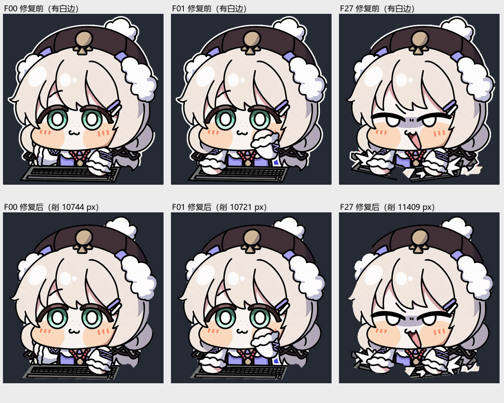

# WtClickerFusion

**WuwaTappo 智能连点器 · 融合版** —— 把「精确状态桥调度」「后台点击注入」「自定义桌宠角色窗口」合到同一个 .NET 8 WinForms 程序里。点击不接管鼠标，桌宠窗口透明置顶、鼠标穿透。


> 本项目是个人自动化与桌面渲染技术的学习实践，**仓库源码不包含任何官方游戏程序或登录凭据**。Release 的一键运行包内嵌了第三方官方桌宠程序及其精确桥补丁，仅供个人学习与研究使用，请勿商用或公开二次分发；角色美术为自制/二次创作素材，权利归原作者所有。请遵守所使用软件的服务条款。

---

## 一键运行（推荐，不用装任何东西）

到 **[Releases / v1.0.0](https://github.com/amo-tx/WtClickerFusion/releases/tag/v1.0.0)** 下载 `WtClickerFusion-OneClick-v1.0.0.zip`（约 175 MB），然后：

1. **完整解压**到任意文件夹（不要只解压单个文件）。
2. 双击 `一键运行.bat`；中文文件名若乱码就双击 `RUN.bat`。
3. 弹出 UAC 时点「是」—— 桌宠是高完整性进程，普通权限下 Windows 会静默拦截点击注入。
4. 完成：自动开始连点并最小化到托盘。可视化监控页 `http://127.0.0.1:48643/`，状态数据 `/stats`。

包里已经带齐**自包含单文件 exe（内嵌打了精确状态桥补丁的桌宠）、5 个角色、默认配置与 .NET 原生库**：不需要安装 .NET 8，不需要安装官方桌宠客户端，不需要编译。首次启动需解压内嵌组件，约 10–30 秒。

```text
WtClickerFusion-OneClick-v1.0.0/
├─ 一键运行.bat / RUN.bat        主入口：自动提权、单实例保护、--start --min
├─ 设置开机自启.bat              可选：登录时自动启动，无 UAC 弹窗
├─ 取消开机自启.bat              可选：撤销自启
├─ 使用说明.txt / SHA256SUMS.txt 中文说明与全量校验值
├─ WtClickerFusion.exe           自包含单文件
├─ config.ini / characters/      默认配置与 5 个角色
└─ *.dll                         .NET 8 单文件发布外置的原生库（缺一不可）
```

| 环境 | 说明 |
| --- | --- |
| Windows 10/11 x64 | 必需 |
| WebView2 Runtime | Win11 与多数 Win10 已自带；桌宠窗口始终不出现时再装 |
| VC++ 2015–2022 x64 | 多数已装；报 `STATUS_DLL_NOT_FOUND` 时安装 |

主入口带**单实例保护**：重复双击不会抢占 48643 端口导致精确桥回退 OCR 模式。`config.ini` 默认开启宝箱秒领、角色窗口与真实键鼠同步，开箱即用。

> 一键包内嵌第三方官方桌宠程序及其补丁，**仅供个人学习与研究，请勿商用或公开二次分发**；仓库源码不含 `payload/payload.exe`，自行构建仍需自备。包内 `使用说明.txt` 有完整故障排查。

---

## 它解决什么问题

旧版 `WtClickerGUI` 靠屏幕 OCR 读次数与倒计时；融合版改为让桌宠内部的状态桥每秒推送精确读数，调度直接使用服务器时钟，OCR 与宝箱轮询让位给精确模式。同时新增一个独立分层窗口渲染自定义角色，让角色动作和每一次点击严格对应。

| 能力 | 实现 |
| --- | --- |
| 精确调度 | `FusionBridge.cs` 接收 `wt-fusion-bridge.js` 推送的 `次数/左槽/右槽/门槛/时钟`，按双槽到期时间做匀速精准补量 |
| 后台点击 | `PostMessage` 到 `DesktopCatInput` / `Chrome_RenderWidgetHostHWND` 通道，启动竞态时每次按当前窗口重选通道；空白点带窗口矩形与 DPI 校验 |
| 宝箱秒领 | 弹出即领取，看门狗冻结锁存，避免 10 秒振荡 |
| 开机自启 | `Autostart.cs` 注册计划任务，登录后立即开始连点 |
| 可视化面板 | 内置 HTTP 服务：`GET /` 状态页、`GET /stats` JSON、`POST /state` 仅回环可写 |
| 自定义角色 | `CharacterLibrary.cs` 扫描 `characters/`，`CharacterWindow.cs` 用 `WS_EX_LAYERED \| TRANSPARENT \| NOACTIVATE` + 预乘 alpha 渲染 |
| 真实输入同步 | `InputTapHook.cs` 全局低级键鼠钩子；真实点击/按键与注入点击共用同一个序号，PostMessage 不经过低级钩子，因此不会重复计数 |

---

## 角色与动画

内置 5 个角色：`Denia`、`娜波摩`、`菲比`、`赞妮`、`露帕`。每个目录一个 `character.json`，声明 `animations`（`idle` / `slap_l` / `slap_r` / `frenzy_l` / `frenzy_r`）、`outfits`、`fps`、`scale`、`frenzyChance`。角色窗口按**点击序号**驱动：奇偶交替播放左右手拍打，概率触发兴奋狂拍时 `frenzy_l → frenzy_r` 完整播完才回到平静状态，期间点击仍然计数并补回同步相位。


`娜波摩` 的素材由视频逐帧抠图生成。源视频自带一圈贴纸白描边，且缩放会把白色插值进透明区，在深色桌面上形成白晕；`tools/import_nabo.py` 里的 `strip_sticker_rim()` 在最终画布整带内缩外圈、重羽化并清零透明区 RGB，保留内部白色（头发、毛球、手套）。




---

## 从源码构建（进阶）

只是想用程序的话，直接看上面的「一键运行」。

**环境**：Windows 10/11 x64、.NET 8 SDK（仅构建时需要）、Python 3 + Pillow/OpenCV（仅重生成角色素材或跑验收脚本时需要）。

```bash
# 1. 准备依赖（见下方「构建依赖」）
# 2. 单文件发布
dotnet publish -c Release -r win-x64 --self-contained true \
  -p:PublishSingleFile=true -p:EnableCompressionInSingleFile=true \
  -p:IncludeNativeLibrariesForSelfExtract=true -o dist_new

# 3. 把 characters/ 复制到 dist_new/ 同级（csproj 用 Content 外部复制，不内嵌）
# 4. 运行 dist_new/WtClickerFusion.exe --start --min
```

启动后：打开主窗体点「测试一次」确认注入通道有效，再点「开始连点」。状态页访问 `http://127.0.0.1:48643/`，机器可读状态为 `/stats`。

`config.ini` 常用项：

| 键 | 说明 |
| --- | --- |
| `maxCps` | 最快速率上限，实际速率由精确桥调度决定 |
| `autoChest` / `humanize` / `pacedBubble` | 宝箱秒领、拟人抖动、气泡节奏 |
| `channel` | 注入通道，`0` = 自动 |
| `petName` / `petEnabled` / `petScale` / `petPos` / `petDrag` | 角色选择、缩放、位置与拖动 |
| `petRealInput` | 真实鼠标/键盘输入是否同步驱动角色 |

命令行参数：`--start`（启动即连点）、`--min`（最小化）、`--web`（面板对局域网开放只读）、`--cdp`（WebView2 9223 调试端口）、`--selftest`（无头抓帧自检）。

---

## 目录结构

| 路径 | 内容 |
| --- | --- |
| `*.cs` / `WtClickerFusion.csproj` | 主程序源码（引擎、精确桥、OCR、注入、UI、角色窗口、自启） |
| `characters/` | 5 个角色的帧图与 `character.json` |
| `docs/` | 本 README 使用的示意图 |
| `tools/make_onekey.py` | 可复现地生成 Release 的一键运行包（从 `dist/` 挑选最小可运行集） |
| `tools/import_nabo.py`、`strip_white_rim.py`、`white_edge_check.py` | 角色抠图、去白边、边缘复核 |
| `tools/extract_frames.py`、`analyze_hands.py`、`hand_states.py` | 视频逐帧导出与动作相位分析 |
| `tools/verify_*.py` | 实机验收：角色切换、动画状态机、点击同步、真实键鼠输入 |

验收示例（`<PID>` 为运行中的进程号）：

```bash
python tools/verify_all_pets.py <PID> dist_new/WtClicker.log   # 全部角色切换重绘
python tools/verify_nabo_states.py <PID> 30                     # 30 秒左右手交替 / 兴奋段
python tools/verify_real_input.py <PID>                         # 真实键鼠与注入去重
python tools/make_onekey.py                                     # 重新打包一键运行包
```

---

## 构建依赖与已知限制

- **`payload/payload.exe` 未包含在源码里**：它是打了精确状态桥补丁的官方桌宠程序，作为 `EmbeddedResource` 内嵌进单文件 exe，属于第三方二进制。没有它 `dotnet publish` 会缺资源；Release 的一键包已包含编译好的成品。
- **精确桥补丁 `wt-fusion-bridge.js` 未包含**：它属于配套的 `Wuwatappo_Helper` 项目，负责在桌宠内部 POST 状态；没有它程序会回退到 OCR 模式。
- **仓库内不存放二进制**：`dist/` `bin/` `obj/`、抓帧截图、源视频与云端部署脚本均由 `.gitignore` 排除（截图可能含联机玩家昵称）。编译产物只通过 Release 资产分发。
- 深色背景上白色毛球/手套周围仍可能有个别离散高光点（源素材 + GDI+ 双三次插值 overshoot），已不是连续白边。

---

## 相关

- 上一代项目：`amo-tx/WtClickerGUI`（纯 OCR 调度版）
- 配套补丁与 Helper：`Wuwatappo_Helper`（本地项目）
