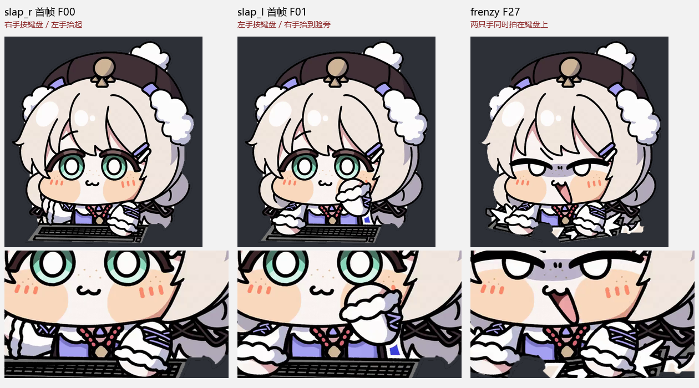
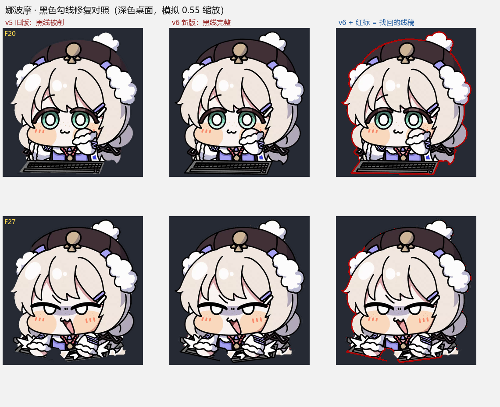

# WtClickerFusion

**WuwaTappo 智能连点器 · 融合版** —— 把「精确状态桥调度」「后台点击注入」「自定义桌宠角色窗口」合到同一个 .NET 8 WinForms 程序里。点击不接管鼠标，桌宠窗口透明置顶、鼠标穿透。


> 本项目是个人自动化与桌面渲染技术的学习实践，**仓库源码不包含任何官方游戏程序或登录凭据**。Release 的单文件 exe 内嵌了第三方官方桌宠程序及其精确桥补丁，仅供个人学习与研究使用，请勿商用或公开二次分发；角色美术为自制/二次创作素材，权利归原作者所有。请遵守所使用软件的服务条款。

---

## 单文件版：下载一个 exe，双击即用

到 **[Releases / 最新版](https://github.com/amo-tx/WtClickerFusion/releases/latest)** 下载 **`WtClickerFusion.exe`**（约 167 MB，Windows 10/11 x64）：

> **当前版本 `v1.1.1`**（2026-11-10 黑色勾线修复版，`SHA256` 前 16 位 `7866b83982f4c876`）。`v1.1.0` 的 exe 也已是同一修复版，但它的 tag 指向修复前源码，自动附带的源码包不含本次修复；需要源码请用 `v1.1.1`。

1. 下载到任意文件夹（桌面、下载目录都行）。
2. **双击它**。
3. Windows 弹出 UAC 时点「是」；若 SmartScreen 提示「Windows 已保护你的电脑」，点「更多信息 → 仍要运行」（无签名的个人项目都会这样）。
4. 完事 —— 自动开始连点、自动显示桌宠角色，无需任何配置。可视化监控页 `http://127.0.0.1:48643/`。

**为什么不用解压、不用装东西**：这一个 exe 里已经打包了全部内容 ——

| 内嵌内容 | 说明 |
| --- | --- |
| .NET 8 运行时 | 自包含单文件，不需要安装 .NET SDK / Runtime |
| 打了精确状态桥补丁的桌宠 | 运行时释放到用户目录，不需要安装官方客户端、不改动已装版本 |
| 5 个自定义角色的 41 个文件 | 首次启动释放到 `%LOCALAPPDATA%\WtClickerFusion\assets\characters\` |
| 出厂默认配置 | 自动生成 `config.ini`，默认开启角色窗口、宝箱秒领、真实键鼠同步 |

程序会把运行期文件统一放在 `%LOCALAPPDATA%\WtClickerFusion\`（`assets/`、`runtime/`、`config.ini`），**exe 旁边不会多出一堆文件**。`config.ini` 可用记事本改；改完重启生效。若想换成自己的角色，在 exe 同目录新建一个 `characters/` 文件夹放 PetForge 格式角色目录，程序会优先用外部的。

| 环境 | 说明 |
| --- | --- |
| Windows 10/11 x64 | 必需；必须允许 UAC 提权（桌宠是高完整性进程，普通权限下 Windows 会静默拦截点击注入） |
| WebView2 Runtime | Win11 与多数 Win10 已自带；桌宠窗口始终不出现时再装 |
| VC++ 2015–2022 x64 | 多数已装；报 `STATUS_DLL_NOT_FOUND` 时安装 |

- **开机自启**：打开主窗口勾选「开机自启」即可（注册计划任务，登录自动开始、无 UAC 弹窗）。
- **停止连点**：点托盘图标退出程序。
- **不要重复双击**：已在运行就别再开第二个，否则 48643 端口被占会回退 OCR 模式。

> 历史版本：`v1.0.0` 的 zip 整合包需要解压、需要点 bat；`v1.1.0` 是首个单文件版。两者均已不推荐，仅作存档，请直接下最新版。

---

## 它解决什么问题

旧版 `WtClickerGUI` 靠屏幕 OCR 读次数与倒计时；融合版改为让桌宠内部的状态桥每秒推送精确读数，调度直接使用服务器时钟，OCR 与宝箱轮询让位给精确模式。同时新增一个独立分层窗口渲染自定义角色，让角色动作和每一次点击严格对应。

| 能力 | 实现 |
| --- | --- |
| 精确调度 | `FusionBridge.cs` 接收 `wt-fusion-bridge.js` 推送的 `次数/左槽/右槽/门槛/时钟`，按双槽到期时间做匀速精准补量 |
| 后台点击 | `PostMessage` 到 `DesktopCatInput` / `Chrome_RenderWidgetHostHWND` 通道，启动竞态时每次按当前窗口重选通道；空白点带窗口矩形与 DPI 校验 |
| 宝箱秒领 | 弹出即领取，看门狗冻结锁存，避免 10 秒振荡 |
| 开机自启 | `Autostart.cs` 注册计划任务，登录后立即开始连点 |
| 可视化面板 | 内置 HTTP 服务：`GET /` 状态页、`GET /stats` JSON、`POST /state` 仅回环可写 |
| 自定义角色 | `CharacterLibrary.cs` 扫描角色目录，`CharacterWindow.cs` 用 `WS_EX_LAYERED \| TRANSPARENT \| NOACTIVATE` + 预乘 alpha 渲染 |
| 真实输入同步 | `InputTapHook.cs` 全局低级键鼠钩子；真实点击/按键与注入点击共用同一个序号，PostMessage 不经过低级钩子，因此不会重复计数 |
| 单文件自包含 | `EmbeddedAssets.cs` 把角色素材从 exe 的 `WtAsset/` 资源释放到用户目录，并写入出厂默认配置 |

---

## 角色与动画

内置 5 个角色：`Denia`、`娜波摩`、`菲比`、`赞妮`、`露帕`。每个目录一个 `character.json`，声明 `animations`（`idle` / `slap_l` / `slap_r` / `frenzy_l` / `frenzy_r`）、`outfits`、`fps`、`scale`、`frenzyChance`。角色窗口按**点击序号**驱动：奇偶交替播放左右手拍打，概率触发兴奋狂拍时 `frenzy_l → frenzy_r` 完整播完才回到平静状态，期间点击仍然计数并补回同步相位。



`娜波摩` 的素材由视频逐帧抠图生成。源视频外轮廓是「白色贴纸描边 → 黑色勾线 → 角色内部」，描边厚度随帧/部位在 1~5px 间变化；缩放还会把白色插值进透明区，在深色桌面上形成白晕。`tools/import_nabo.py` 里的 `strip_sticker_rim()` 采用**颜色感知的自适应内缩**：只删与背景连通的那圈白色，遇到深色勾线自动停刀；半透明带只修正近白像素、颜色用最近邻外扩，并清零近透明区 RGB。因此白边去掉的同时，人物黑色勾线完整保留（早期 v5 用固定宽度整带内缩，会把描边薄的帧里的黑线一起削掉，已修复）。




---

## 从源码构建（进阶）

只是想用程序的话，直接下上面的单文件 exe。

**环境**：Windows 10/11 x64、.NET 8 SDK（仅构建时需要）、Python 3 + Pillow/OpenCV（仅重生成角色素材或跑验收脚本时需要）。

```bash
# 1. 准备依赖（见下方「构建依赖」）
# 2. 单文件发布（characters/ 会以 EmbeddedResource 编进 exe）
dotnet publish -c Release -r win-x64 --self-contained true \
  -p:PublishSingleFile=true -p:EnableCompressionInSingleFile=true \
  -p:IncludeNativeLibrariesForSelfExtract=true -o dist_new

# 3. 直接运行 dist_new/WtClickerFusion.exe，不需要复制 characters/
```

**双击默认自动开始连点**（`Program.cs` 里 `startArg = !args.Contains("--nostart")`）；命令行参数：

| 参数 | 作用 |
| --- | --- |
| `--nostart` | 不自动开始，需手动点「开始连点」 |
| `--min` | 启动即最小化到托盘 |
| `--web` | 监控面板对局域网开放只读 |
| `--cdp` | 桌宠 WebView2 开 9223 调试端口 |
| `--selftest` | 无头抓帧自检（不需管理员、不占端口） |

`config.ini` 常用项（单文件版落在 `%LOCALAPPDATA%\WtClickerFusion\config.ini`）：

| 键 | 说明 |
| --- | --- |
| `maxCps` | 最快速率上限，实际速率由精确桥调度决定 |
| `autoChest` / `humanize` / `pacedBubble` | 宝箱秒领、拟人抖动、气泡节奏 |
| `channel` | 注入通道，`0` = 自动 |
| `petName` / `petEnabled` / `petScale` / `petPos` / `petDrag` | 角色选择、缩放、位置与拖动 |
| `petRealInput` | 真实鼠标/键盘输入是否同步驱动角色 |

---

## 目录结构

| 路径 | 内容 |
| --- | --- |
| `*.cs` / `WtClickerFusion.csproj` | 主程序源码（引擎、精确桥、OCR、注入、UI、角色窗口、自启、内嵌资源引导） |
| `characters/` | 5 个角色的帧图与 `character.json`（构建时编进 exe，运行时释放） |
| `docs/` | 本 README 使用的示意图 |
| `tools/import_nabo.py`、`strip_white_rim.py`、`white_edge_check.py` | 角色抠图、去白边、边缘复核 |
| `tools/extract_frames.py`、`analyze_hands.py`、`hand_states.py` | 视频逐帧导出与动作相位分析 |
| `tools/verify_*.py` | 实机验收：角色切换、动画状态机、点击同步、真实键鼠输入 |

验收示例（`<PID>` 为运行中的进程号）：

```bash
python tools/verify_all_pets.py <PID> dist/WtClicker.log   # 全部角色切换重绘
python tools/verify_nabo_states.py <PID> 30                 # 30 秒左右手交替 / 兴奋段
python tools/verify_real_input.py <PID>                     # 真实键鼠与注入去重
```

---

## 构建依赖与已知限制

- **`payload/payload.exe` 未包含在源码里**：它是打了精确状态桥补丁的官方桌宠程序，作为 `EmbeddedResource` 内嵌进单文件 exe，属于第三方二进制。没有它 `dotnet publish` 会缺资源；Release 的单文件 exe 已包含成品。
- **精确桥补丁 `wt-fusion-bridge.js` 未包含**：它属于配套的 `Wuwatappo_Helper` 项目，负责在桌宠内部 POST 状态；没有它程序会回退到 OCR 模式。
- **仓库内不存放二进制**：`dist/` `bin/` `obj/`、抓帧截图、源视频与云端部署脚本均由 `.gitignore` 排除（截图可能含联机玩家昵称）。编译产物只通过 Release 资产分发。
- 单文件 exe 未做代码签名，首次运行会触发 SmartScreen / UAC，属预期行为。
- 深色背景上白色毛球/手套等**内部白色区域**放大观察时仍可能有细碎高光点（源素材 + GDI+ 插值 overshoot）；外轮廓的连续白边与黑色勾线断裂已在 v6 抠图链路修复，透明区白像素已归零。

---

## 相关

- 上一代项目：`amo-tx/WtClickerGUI`（纯 OCR 调度版）
- 配套补丁与 Helper：`Wuwatappo_Helper`（本地项目）
